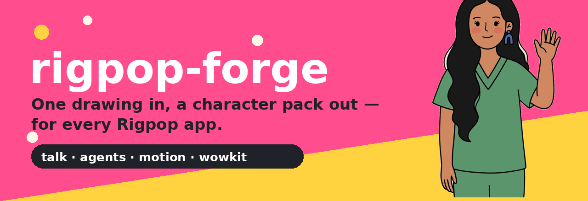
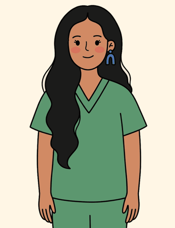
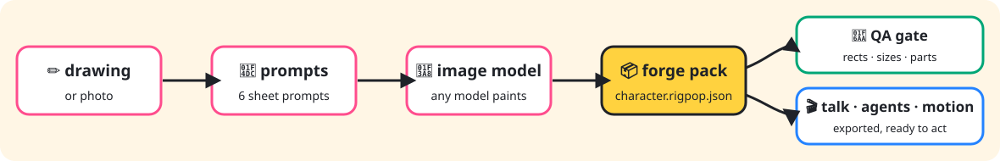
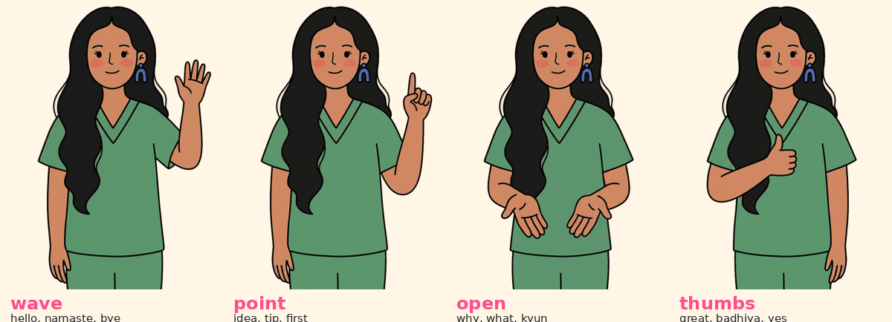
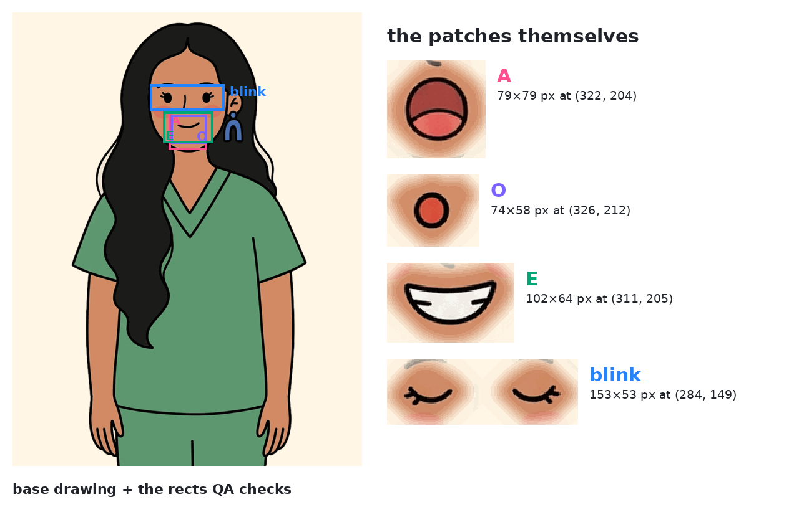

# rigpop-forge



    

**v0.6 is here:** characters get cast — voice presets (`voice`) and
two-character scenes (`duet`). Still zero dependencies.

📦 **Live demo registry:** this repo ships one in `demo-registry/`
(Doodle Swapnil, fetchable). Once Pages is enabled (Settings → Pages →
GitHub Actions — see `demo-registry/DEPLOY.md`) it serves at
[swapagrawal14.github.io/rigpop-forge](https://swapagrawal14.github.io/rigpop-forge/)
and `rigpop-forge fetch https://swapagrawal14.github.io/rigpop-forge/ kdswapnil --out ./characters` just works.

**The character factory for the Rigpop family.** Engines were never the
problem — talking busts, agent-rendered videos, full cartoons, ink restyles,
living websites all exist. Making a *character* was the problem: manual in
every app, in a different format in every repo.

Forge fixes that. Author a character **once** as a `character.rigpop.json`
pack ([SPEC.md](SPEC.md)), pass it through the QA gate, export it anywhere.

<p align="center">
  
</p>

<p align="center"><em>Doodle Swapnil — a real Forge pack (examples/doodle-swapnil), imported from rigpop-talk in one command.</em></p>

## How it flows



## Meet the gesture poses

Every pack ships four full-canvas poses. Talk and Agents fire them from
*words* in the script — no timeline editing:



## What the QA gate actually checks

Exports and packing **refuse** a character that fails QA. The checks that
matter most are geometric — patch image size must equal its rect, rects must
stay on the canvas, base and poses must be exactly canvas-sized:



A character that animates perfectly and never blinks or speaks is a silent
failure. Forge makes it a loud one.

## Quickstart

```bash
# start a new character (+ all six sheet prompts, generated for you)
node bin/rigpop-forge.js init aarav-2 --out characters/aarav-2 --voice hi-IN-MadhurNeural

# paint the art: prompts/00-model-sheet.md first — it is the reference for
# every other sheet. Then let Forge do the measuring:

node bin/rigpop-forge.js cut characters/aarav-2        # sheets -> parts + motion/rig.json
node bin/rigpop-forge.js facepack characters/aarav-2   # states -> talk patches + rects
node bin/rigpop-forge.js qa characters/aarav-2
node bin/rigpop-forge.js export talk characters/aarav-2 ../rigpop-talk/characters
node bin/rigpop-forge.js export motion characters/aarav-2 ../rigpop-motion
node bin/rigpop-forge.js pack characters/aarav-2 --out dist
```

Already have a character in rigpop-talk or rigpop-agents? Adopt it:

```bash
node bin/rigpop-forge.js import-talk ../rigpop-talk/characters kdswapnil \
  --out examples/doodle-swapnil --name "Doodle Swapnil" --voice en-IN-NeerjaExpressiveNeural
# ✓ imported kdswapnil as a Forge pack at examples/doodle-swapnil — qa: PASS
```

## The commands

| Command | What it does |
| --- | --- |
| `init <id> --out <dir>` | Scaffold a pack: manifest, folders, and all six sheet prompts |
| `prompts <pack>` | Regenerate sheet prompts from the pack's style bible |
| `import-talk <charactersDir> <id>` | Adopt an existing Talk/Agents character (files + characters.json rects) |
| `qa <pack>` | The gate — patch sizes vs rects, on-canvas checks, motion parts, pose-pack keys |
| `export talk\|agents <pack> <out>` | Flat `<id>_*.png` files + merged `characters.json`, exactly where the app expects them |
| `export motion <pack> <out>` | `characters/<id>/` with `rig.json`, pose packs, and a script cast snippet |
| `pack <pack> --out <dir>` | Bundle `<id>.rigpop-pack/` with a sha256 content index (diffable, cacheable) |
| `cut <pack>` | **v0.2** — chroma-key the `sheets/` sheets, cut components in reading order into `parts/`, estimate anchors, write `motion/rig.json` |
| `facepack <pack>` | **v0.2** — diff `states/{A,O,E,blink}.png` against the base and derive the talk patches + rects automatically |
| `export wowkit <pack> <repo>` | **v0.3** — WowKit v2 project: base cutout + 15 estimated joints + a gentle-sway loop |
| `facepacks <pack> [--face x,y,w,h]` | **v0.3** — pose-pack blink/mouth tiles, skin-sampled per key, indexed in `pack.json` |
| `publish <pack> --registry <dir>` | **v0.3** — QA-pack a character into a registry and rebuild its catalog |
| `registry build <dir>` | **v0.3** — rebuild `registry.json` + the static gallery |
| `fetch <registry> <id> --out <dir>` | **v0.4** — pull a pack by id from a registry folder or URL, sha256-verified per file |
| `tune <pack> [--set torso:hip.y=512]` | **v0.4** — list/adjust rig anchors; renders `motion/rig-preview.png` with anchors drawn on the parts |
| `normalise <pack>` | **v0.4** — pose-pack keys onto one height + floor line, face rects follow |
| `sleeves <pack>` | **v0.5** — paint the arm sleeve caps into the torso at the shoulders, so joints never show a gap |
| `hose <pack>` | **v0.5** — rubber-hose strips for limb parts: every row resampled to one median width |
| `registry site <dir> --out <site>` | **v0.5** — deployable static site + GitHub Pages workflow for a registry |
| `voice <pack> --preset neerja` | **v0.6** — cast a voice from the Edge preset roster (`voice --list`) |
| `duet <packA> <packB> --out <dir>` | **v0.6** — two packs → one scene: merged cast, stage placements, starter script |

## The sheet prompts

One pose = one generation. Chroma-green ground. A blank face on the head
sheet; eyes and mouths arrive as their own kit. Every prompt repeats the
pack's style bible and passes the model sheet as reference, in a reading
order the auto-cutter understands (`"eyes.open*2"`, `"mouth.laugh>0.47"`).
These are the conventions rigpop-motion's auto-rig was built on — Forge
writes them down and generates them for you.

## The Rigpop family

| Repo | Role |
| --- | --- |
| **rigpop-forge** | Characters *(you are here)* |
| [rigpop-talk](https://github.com/swapagrawal14/rigpop-talk) | Browser app: doodles that talk |
| [rigpop-agents](https://github.com/swapagrawal14/rigpop-agents) | CLI/MCP: scripts in, talking videos out |
| [rigpop-motion](https://github.com/swapagrawal14/rigpop-motion) | Full cartoon animation: hybrid rigs + pose packs |
| [rigpop-ink](https://github.com/swapagrawal14/rigpop-ink) | Footage that redraws itself as ink |
| wowkit | Websites with living Rigpop characters |

## What's new in v0.2

- **`cut`** — the auto-cut + auto-rig port: chroma keying by greenness,
  connected components, speck removal, reading-order label matching
  (including `eyes.open*2` pair parts), tight crops, and a rigpop-motion
  `rig.json` with silhouette-estimated anchors (face ellipse, torso
  neck/shoulders/hip, limb ends, eye/mouth centres, sampled skin/hair).
- **`facepack`** — draw the base once, then draw it again with only the
  mouth (or eyes) changed, per state. Forge diffs, crops and writes the
  patch + rect. On the real Doodle Swapnil art it re-derived a 66×78 rect
  nested inside the original hand-measured 79×79 patch — the tight mouth
  region plus margin, exactly as intended. Drifted state drawings (whole
  canvas changed) are rejected.
- **A pure-JS PNG codec** (`src/pngcodec.mjs`) — decode (grey/RGB/palette/
  alpha, 8/16-bit) + encode on Node's zlib, so Forge keeps zero deps.

## What's new in v0.3

- **`export wowkit`** — a real WowKit v2 project (format verified against
  WowKit's own cast files): the base drawing as the cutout, a 15-joint
  skeleton estimated from the pack's face geometry, and a generated
  gentle-sway animation in the cast's units. On Doodle Swapnil the head
  joint lands at x=361 — her face centre is 360. Estimates are flagged in
  the file; refine them in WowKit's workshop.
- **`facepacks`** — pose packs stop being mute: every key gets a blink tile
  and five mouth tiles (rest/M/A/O/E), each filled with skin sampled in a
  ring around its rect *on that key* (Motion's facepatch trick), indexed
  in the pack's `pack.json`. QA now warns when a pose pack has none.
- **The registry** — `publish` drops a QA-passed `.rigpop-pack` into a
  registry folder; `registry build` regenerates `registry.json` and a
  static gallery page. A folder + JSON: boring tech every app can read.

## What's new in v0.4

- **`fetch`** — registries are now two-way: pull any pack by id from a
  registry folder *or* a hosted URL, with every file sha256-verified
  against its pack index before it lands.
- **`tune`** — the anchor hand-tuning helper: lists every rig anchor,
  `--set torso:hip.y=512` adjusts one (and clears the `anchorsEstimated`
  flag once a human has tuned), and every run renders
  `motion/rig-preview.png` — the parts with their anchor points drawn on,
  so estimates can be checked by eye instead of by JSON.
- **`normalise`** — Motion's hardest pose-pack lesson as a command: keys
  rescaled to one figure height, bbox bottoms on one floor line, figures
  centred. Face rects move by the average transform; stale face tiles are
  removed rather than silently kept (re-run `facepacks`).

## What's new in v0.5

- **`sleeves`** — rigpop-motion's shoulder fix: the top of the upper-arm
  part is composited onto the torso at both shoulder anchors (mirrored
  for the right side), so a rotating arm never opens a crescent of
  background at the joint. Original torso kept as `torso.nosleeve.png`.
- **`hose`** — rubber-hose strips: each limb part also ships a
  straightened strip (every row resampled to the median width, centred)
  that a renderer can bend along a curve without shearing the art.
- **`registry site`** — a registry becomes a website: gallery, catalog
  and packs copied into a deployable folder with a ready GitHub Pages
  workflow and a `DEPLOY.md`. Host it, and `fetch` works against the URL.

## What's new in v0.6

- **`voice`** — casting instead of memorising voice ids: a preset roster
  (neerja, aashi, prabhat, ava, andrew, sonia, ryan…) that writes
  `{engine, id, preset}` into the manifest. Doodle Swapnil's Neerja is
  literally preset #1.
- **`duet`** — two QA-passed packs become a scene: both characters
  exported into one `characters/` folder with a merged index, a
  `duet.json` stage (common height, one floor line, left/right
  placements, cast voices), and a starter `script.md` with lines tagged
  by character id, ready for Talk's duet stage or Agents.

## What's new in v0.7

- **`talk.poseAnchors`** — per-pose mouth/eye centres in the manifest
  (SPEC.md). The base-pose patch rects drift on gesture poses because the
  head moves; anchors are how a renderer lip-syncs *every* pose. The four
  Agrawal family packs carry hand-verified anchors, and their pose art is
  normalised to one figure height per character.
- **`tools/cartoon-render`** — an optional Python renderer that turns
  packs into a full cartoon episode: staged scenes, a moving camera
  (close-ups, two-shots, push-ins, pans), walking entrances, gestures that
  change mid-sentence at phrase boundaries, reaction poses, and
  audio-envelope lip-sync. Worked example included: the family pilot
  *The Agrawal Family — Episode 1* (3 scenes, 28 shots, 2:51).

## Roadmap

- **Later — scene scripts to Agents:** duet bundles rendered straight to
  voiced MP4 by rigpop-agents.

## Tests & visuals

```bash
npm test   # node --test, zero dependencies, Node >= 20
```

The images on this page are generated from the real example pack —
regenerate them with `python3 docs/brand/build-assets.py` (Pillow, dev-only)
whenever the example art changes.

MIT © Swapnil Agrawal. Character art in `examples/` and `docs/assets/` is
Swapnil's own brand art — the code is MIT, please don't reuse the character
as your own brand.
